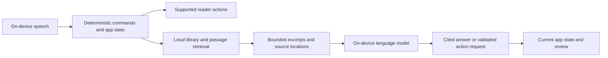

# Fily and the Xfiles AI engine

[App guide](README.md) · [On-device assistant](#on-device-assistant) · [Retrieval](#retrieval-and-app-state) · [Training](#training-and-evaluation) · [MCP](#desktop-mcp)

## On-device assistant

Fily finds authorized files, answers questions with citations when text is available, and controls the active reader. Try “Find my latest resume,” “When is this invoice due?” or “Go to the next sheet.” The app can open supported tools for review. Saving, sending, printing and sharing follow the app or system confirmation flow.

| Platform | Inference and speech |
| --- | --- |
| Android | The app uses an LFM2.5-350M fine-tune through llama.cpp, hosted in a Rust worker. Install the approved GGUF from Fily settings by download or local import. The one-time download is optional. Voice input requires an on-device recognizer on Android 12 or later, and spoken replies require an installed offline TTS voice. |
| iOS and iPadOS | Local generation uses Apple Foundation Models on eligible devices with iOS 26 or later and the model available. When generation is unavailable, matching excerpts and deterministic actions remain available. Dictation requires on-device speech recognition and microphone permission. |

Android checks the installed model against the approved file metadata. The model asset is `Fily-EzFiles-350M-Q8_0.gguf`. The asset name uses the original project name. The [model manifest](sharedLogic/src/commonMain/kotlin/com/xfiles/fily/ModelDownloads.kt) defines its size and SHA-256. [Model release](https://github.com/kishore-bot/X-Files/releases/tag/models-v1)

## Retrieval and app state



- **Fast path.** QuickCommands handle supported navigation and scrolling without a model turn. The active reader exposes its available operations. On iOS, the model receives excerpts and the app routes file actions.
- **App state.** Android supplies authoritative capability facts, the active screen, document identity and position, selected aliases, available actions, and the last reported action outcome in `APP_STATE`. The app checks tool arguments against the authorized library and current viewer. It refreshes state on subsequent turns and reports completed work from the app's actual result. [Prompt contract](sharedLogic/src/commonMain/kotlin/com/xfiles/fily/FilyPrompt.kt) · [Session](sharedLogic/src/commonMain/kotlin/com/xfiles/fily/FilySession.kt)
- **Hybrid retrieval.** The library uses filename ranking and BM25 content search. For an open document, Rust combines passage-level BM25 with compact English business-concept vectors using reciprocal rank fusion. Queries containing digits take the lexical ranking path for exact terms. Passage selection reduces repetition and keeps page references where available. Passages are data for grounding and have no authority to issue instructions. [Passage ranking](engine/crates/document-search/src/passage.rs)
- **Inference.** The Android Rust worker owns the llama.cpp context, serializes generation and can reuse cached prompt tokens. Structured outputs are constrained by the app's grammar and validated before executing an action. CPU is the default. `-Pfily.opencl=true` opts into the experimental OpenCL build, which needs compatible drivers and separate packaging and recovery validation. [Rust worker](engine/crates/fily-inference/src/android.rs) · [Android engine configuration](documentEngine/build.gradle.kts)
- **Evidence limits.** Image-only or inaccessible pages can lack retrievable text. Answer quality depends on the supplied excerpt and the model. For comparisons, freeze the device, corpus, prompt and model checksum. Measure passage recall, generated citation accuracy, first-token and speech-to-audio latency, sustained decode rate, and peak memory. Record cold versus warm runs and actual backend.

A beta.05 CI fixture with five labelled queries found the correct first page for 2/5 with BM25, 4/5 with concept vectors, and 5/5 with hybrid retrieval. The small fixture measures ranking only. [CI run](https://github.com/kishore-bot/X-Files/actions/runs/45913509970)

Android AppFunctions expose selected Xfiles workflows on supported Android versions. Assistant access and document-text sharing have separate consent gates. Treat a foreground handoff as a request for review. The user completes saving or delivery in the app or system surface. Client registration and availability depend on the device. [Android tool host](androidApp/src/main/kotlin/com/xfiles/android/appfunctions/FilyToolHost.kt)

## Training and evaluation

Most product improvements start with correct runtime app state, retrieval, or tool handling. Retraining is for measured model behavior gaps such as invented IDs, weak grounding, or inconsistent structured output. Keep the current and candidate models measurable against the same held-out tasks.

The [training directory](training) contains the Python pipeline, tool catalog and a historical capability snapshot. Virtual environments, generated datasets, llama.cpp tools, checkpoints and exports are local artifacts. Rebuilding a dataset against today's [format table](README.md#supported-files) produces a new manifest. The tracked capability JSON preserves the historical curriculum and its original source digest.

### Setup and datasets

From the repository root on Windows, use Python 3.13 and an NVIDIA GPU with CUDA 12.4 for the documented training environment. Place [LFM2.5-350M](https://huggingface.co/LiquidAI/LFM2.5-350M) in `~\Downloads\LFM2` or set `FILY_BASE_MODEL` to its location. Review the base model license before distributing a derivative.

```powershell
py -3.13 -m venv training\.venv
.\training\.venv\Scripts\python.exe -m pip install -r training\requirements-lock.txt
.\training\.venv\Scripts\python.exe training/get_quant_tools.py
.\training\.venv\Scripts\python.exe training/build_dataset.py
.\training\.venv\Scripts\python.exe training/build_hard_dataset.py
.\training\.venv\Scripts\python.exe training/build_domain_dataset.py
.\training\.venv\Scripts\python.exe training/build_edge_curriculum.py
.\training\.venv\Scripts\python.exe training/build_app_v8.py
.\training\.venv\Scripts\python.exe training/validate_dataset.py
```

The seeded builders cover base tasks, contrasting commands, in-domain help, edge cases, and app-faithful conversations. The v8 curriculum includes document aliases, grounded citations, speech recognition slips, and follow-up actions. Historical fixtures may describe capabilities from an earlier build.

### Train, export and verify

The five-hour runner trains, exports GGUF, calibrates quantization and evaluates the output. Supply an existing adapter checkpoint, the baseline GGUF at `training/exports/fily-domain-v4/`, and the local `training/data/grounded_domain_test.jsonl` evaluation fixture. The baseline and grounded fixture are local prerequisites. Resume with the same options and `--resume`. Use the status script to inspect the job. The completion report stays under the run directory.

```powershell
.\training\.venv\Scripts\python.exe training/run_five_hour.py --data app_v8 --output runs/fily-app-v8 --init-adapter runs/fily-edge-v5-5h/checkpoint-003102
.\training\.venv\Scripts\python.exe training/status_five_hour.py
.\training\.venv\Scripts\python.exe -m unittest discover -s training -p "test_*.py" -v
```

Score a candidate with [eval_harness.py](training/eval_harness.py) against the same held-out suite as the baseline. Compare tool selection and arguments, grounding and citations, unauthorized-action refusal, and follow-up behavior with per-metric sample counts. Separately exercise the Android grammar, live state, confirmation flow, and cold and warm performance on a phone.

Keep the [training catalog](training/tool_catalog.json) in sync with the [Android host test fixture](sharedLogic/src/androidHostTest/resources/fily/tool_catalog.json). The [prompt contract test](sharedLogic/src/androidHostTest/kotlin/com/xfiles/fily/FilyPromptContractTest.kt) covers the app's expected prompt structure. Validate any prompt or tool schema change end to end before shipping it with a model. Update the manifest name, size and SHA-256 together with the published asset when replacing weights.

## Desktop MCP

The [xfiles-mcp crate](engine/crates/xfiles-mcp) is a host-only Rust server for desktop AI clients. It connects over stdio, calls Rust parsers directly, and runs independently of the mobile assistant. The server runs locally. A desktop client's own model and data policy determines how that client handles returned content.

```sh
cargo build --release --manifest-path engine/Cargo.toml -p xfiles-mcp
engine/target/release/xfiles-mcp --root "$HOME/Documents/Xfiles"
cargo test --manifest-path engine/Cargo.toml -p xfiles-mcp
```

Pass a required `--root <folder>` for each directory the server may use. `--timeout-secs` defaults to 120 with a range of 1–3600. `--max-input-mb` defaults to 256 with a range of 1–2048. Stdout carries protocol messages and stderr carries diagnostics.

| Tools | Capabilities |
| --- | --- |
| `read_document`, `search_document`, `glance` | Read supported Office, OpenDocument, EPUB and text formats, find matching text, or extract key sentences and references. Text operations reject PDFs on the desktop path. |
| `pdf_merge`, `pdf_split`, `pdf_compress`, `pdf_reorder`, `pdf_rotate`, `pdf_watermark`, `pdf_protect` | Transform PDFs and publish new outputs. Splitting can report published parts with `complete: false` after partial publication. |
| `office_find_replace` | Preview replacements or apply them to a verified new output. |
| `list_archive`, `extract_archive_entry` | List archive contents or extract one entry, with a password for supported encrypted entries. |

Paths resolve inside the configured roots, including when following symlinks. Inputs are read-only. Outputs are staged before publication and existing destinations require explicit overwrite. Requests have time and input-size limits, and failures return readable errors.

For Claude Desktop, add a server entry to `claude_desktop_config.json` in the client's settings folder and restart the app. Use the absolute path to the binary and the intended allowed directories.

```json
{
  "mcpServers": {
    "xfiles": {
      "command": "/absolute/path/to/engine/target/release/xfiles-mcp",
      "args": ["--root", "/absolute/path/to/allowed-files"]
    }
  }
}
```

For Claude Code, register the same command and root. On Windows use the `.exe` path.

```sh
claude mcp add xfiles -- /absolute/path/to/xfiles-mcp --root /absolute/path/to/allowed-files
```
