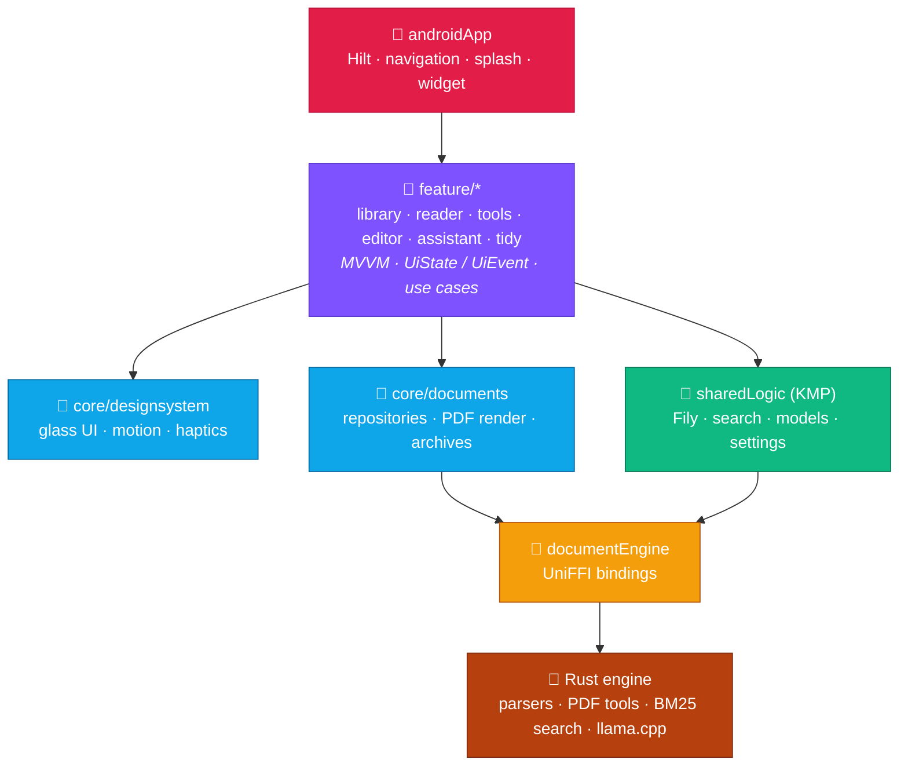

<div align="center">


# Xfiles

### ✨ Premium feel. Faster app. ✨

**Every file, beautifully handled, all on your phone.**
On Android, read PDFs, Office documents, EPUBs, media and archives, and use **Fily**, the on-device assistant. The [iPhone and iPad app](#ios) includes offline readers, document tools, content search, and Fily.

<p>
  <a href="https://github.com/kishore-bot/X-Files/releases/tag/v1.0.0-beta.09"></a>
  <a href="LICENSE"></a>
  
</p>
<p>
  
  
  
  
  
  
</p>

[⬇️ Download](#get-it) · [🌟 Android features](#features) · [iPhone & iPad](#ios) · [🤖 Fily](#fily) · [🏗️ Architecture](#architecture) · [🛠️ Build](#build) · [🤝 Contribute](#contributing)

</div>

---

## 💎 Highlights

| ⚡ **Fast** | 🔒 **Private** | 🎨 **Premium** | 🤖 **Smart** |
|:---:|:---:|:---:|:---:|
| A native Rust engine parses, searches and edits | Offline-first: documents never leave the device | Glass UI, motion and haptics, Material 3 | Fily answers and acts, fully on-device |

---

<a name="get-it"></a>

## ⬇️ Get it

**Xfiles 1.0.0-beta.09** is available as a signed Android APK.

- [Download the APK](https://github.com/kishore-bot/X-Files/releases/download/v1.0.0-beta.09/Xfiles-1.0.0-beta.09.apk)
- [SHA-256 checksum](https://github.com/kishore-bot/X-Files/releases/download/v1.0.0-beta.09/Xfiles-1.0.0-beta.09.apk.sha256)
- [Release notes](https://github.com/kishore-bot/X-Files/releases/tag/v1.0.0-beta.09) · [All releases](https://github.com/kishore-bot/X-Files/releases)

> 🧪 Xfiles is in **beta** (`1.0.0-beta.xx`). Releases are built, tested and signed automatically by GitHub Actions.

---

<a name="features"></a>

## 🌟 Android features

### 📖 Reading

| | Format | Highlights |
|---|---|---|
| 📕 | **PDF** | Continuous scrolling, thumbnails, zoom, single, two-up and grid views; find; annotations (pen, highlight, notes, signatures); text selection, also on scans through OCR; **declared digital signature details** |
| 📘 | **Word · Excel · PowerPoint** | DOCX, XLSX and PPTX (plus ODF and legacy DOC/XLS/PPT); tables as one grid; find & replace; cell editing with frozen panes; slides with **links, audio and video**; presenter |
| 📗 | **EPUB** | **Paged or scroll** reading; contents and notebook; highlights and notes; footnotes; working links; themes (White, Sepia, Green, Dark, Black), fonts and justified text |
| 📝 | **Text · Code · JSON · HTML · SVG** | Syntax highlighting with expand/collapse all; JSON tree and pretty print; working web links; SVG preview and source; text size |
| 🖼️ | **Pictures** | Swipeable folder gallery, sharp tiled zoom, animated images, EXIF |
| 🎬 | **Video · Audio** | Picture-in-picture; gestures; speed control; audio-track switching; subtitles (SRT, VTT, ASS) with styling; AC3, DTS and TrueHD through FFmpeg |
| 🗜️ | **ZIP** | Browse, extract, compress, and open ZipCrypto or AES-encrypted entries |

🎨 **Page style** shows any document in **Original**, **Standard**, **Dark** or **Sepia**.

💡 **At a glance** summarises any file and makes its dates, amounts, phone numbers and links tappable.

### 🧰 Tools

- 📄 **PDF:** merge, split, reorder, rotate, compress, watermark, sign, and password protect or unlock (AES-256).
- 🔁 **Convert:** pictures ⇄ PDF, PDF → text, PDF → ZIP, and text → PDF with templates.
- 📷 **Scanner:** corner adjustment, filters, and searchable (OCR) PDFs.
- 🗜️ **Zip tools:** compress to ZIP and extract, with progress.
- 🧹 **Tidy up:** finds duplicate and unneeded files.

Every tool follows the same visual flow: **Pick → Adjust → Save**, with live previews.

### 📚 Library

- Recent files ranked by **frecency**, plus bookmarks, 12 type filters and typo-tolerant search with full-text search inside documents.
- Multi-select, a home-screen widget, app shortcuts, **Open with** / **Share to** for 40+ types, and **Save to Downloads** for files opened from other apps.

---

<a name="ios"></a>

## Xfiles for iPhone and iPad

The SwiftUI app targets **iOS and iPadOS 17 or later** and uses Swift 6 language mode. It is available as source in this repository, with compilation and device validation pending.

- Import files from Files and keep local copies for offline access.
- Search filenames and document contents. Open PDF hits at the cited page.
- Read PDFs, paged EPUBs with a notebook, Office documents, spreadsheets, and slides. Browse ZIPs, preview images, and use AVKit or the FFmpeg-backed compatibility player for local media.
- Create edited copies, convert text or images to PDF, scan with on-device OCR, and find exact duplicates.
- Ask Fily about local files, open its sources, or control the current reader. Generated answers use Apple Foundation Models where available.

The [iOS architecture and delivery plan](docs/IOS_ARCHITECTURE.md) covers resume state, the shared Rust engine, platform limits, and device validation.

---

<a name="fily"></a>

## 🤖 Fily: the on-device assistant


Fily is a voice assistant running a **350M-parameter model locally** through llama.cpp. It answers questions about your files, with page citations, and uses local tools to open documents, prepare PDF workflows for review, move between pages and spreadsheet tabs, and inspect storage. It speaks its answers back on-device. Voice input requires an on-device recognizer on Android 12 or later. Spoken replies require an installed offline TTS voice.

| 🧠 Technique | 🎯 Why | ⚙️ How |
|---|---|---|
| **Offline hybrid RAG** | Document wording can differ from a question | Rust combines BM25 and compact English business-concept vectors with reciprocal rank fusion. Queries containing digits use BM25 to preserve exact terms. Passages are de-duplicated with MMR and carry PDF page labels. |
| **Live app state** | Reader position and action results can change between tool calls | Android supplies the active screen, PDF page or spreadsheet tab and cell, selected file aliases, available reader operations, and the last reported tool outcome. Direct PDF save questions use the current tool screen's save state. |
| **KV-cache reuse** | Re-reading the long system prompt costs seconds | The context stays alive, and only the new suffix is decoded |
| **GPU crash guard** | Some GPU drivers crash while loading models | A persisted state machine falls back to the CPU |
| **Quick commands** | Instant screen control, no model round-trip | "Scroll down the page" or "next slide" act at once |
| **Prompt contract test** | A retrained model must see the prompt it was trained on | The app's prompt is tested against training fixtures |

The beta.05 Linux runner compared retrieval modes on five labelled queries against the same five-page fixture.

| Retrieval | Correct first page | Mean time per query |
|---|---:|---:|
| BM25 | 2/5 | 1.5 µs |
| Concept vectors | 4/5 | 3.4 µs |
| Hybrid | 5/5 | 3.7 µs |

The shared index was estimated at 2,546 bytes. These figures cover passage retrieval on that fixture. Phone latency and generated citation accuracy require separate measurement. [Beta.05 build and test results](https://github.com/kishore-bot/X-Files/actions/runs/45913509970)

The model downloads once on request from the `models-v1` release. Beta.05 uses the existing 350M weights. [Training and export pipeline](training/README.md)

<details>
<summary>🔌 <b>MCP server: the engine as AI tools</b></summary>

[`engine/crates/xfiles-mcp`](engine/crates/xfiles-mcp) is a **Model Context Protocol** server, built on the official Rust SDK `rmcp`. It gives desktop AI clients such as Claude Desktop and Claude Code the same document engine the app uses, with 13 tools for reading, PDF, Office find & replace and ZIP. Access is sandboxed to the `--root` directories you pass, inputs are never modified, outputs are written atomically, and there's no network access.

```bash
cargo build --release --manifest-path engine/Cargo.toml -p xfiles-mcp
claude mcp add xfiles -- /path/to/xfiles-mcp --root ~/Documents
```
</details>

---

<a name="architecture"></a>

## 🏗️ Architecture



**Stack:**
- **Kotlin 2.4**, Compose BOM 2026.11 with Material 3, Hilt, Coroutines/Flow, Navigation 3, Media3, CameraX, ML Kit and WorkManager.
- **Rust** with UniFFI, llama.cpp and FFmpeg 7.1.
- **AGP 9.5** with R8 full mode and baseline profiles.

---

## 🔒 Privacy

- 📴 **Offline-first:** documents, file names and Fily conversations never leave the phone.
- 🌐 **Internet is used only for:**
  - the one-time Fily model download, when you ask for it;
  - opt-in crash reports;
  - feedback you choose to send.
- 🗑️ **No backups:** uninstalling removes all app data.

---

<a name="build"></a>

## 🛠️ Build from source

### iPhone and iPad

Install the Rust iOS targets, then open `iosApp/Xfiles.xcodeproj` on macOS and select the shared **Xfiles** scheme. The project builds the Rust engine for the selected iOS destination. [Xcode and Rust setup](iosApp/README.md)

### Android

**Requirements:** Linux or WSL, JDK 17, Android SDK (compile SDK 37), NDK `29.0.14206865`, Rust (see `rust-toolchain.toml`) and CMake.

```bash
ANDROID_HOME=~/Android/Sdk bash scripts/build-ffmpeg.sh   # enables FFmpeg audio fallback (LGPL)
./gradlew :androidApp:assembleDevDebug                     # dev build (com.xfiles.dev)
./gradlew :androidApp:assembleProdRelease                  # release build, R8-minified
```

The reader depends on `dev.lazymatrix:lazymatrix:0.1.2`. Gradle finds the Maven
publication at `../../CustomCompose/LazyMatrix/lazymatrix/build/maven` relative to
Xfiles. Use `-PlazyMatrixLocalRepo=/path/to/lazymatrix/build/maven` for a different
local checkout. The `xfiles-maven-0.1.2` branch in LazyMatrix packages upstream
commit `03e9731` at this version. Its Maven publication includes the
`arm64-v8a` and `x86_64` native libraries.

GitHub Actions checks out the pinned AAR, POM, and Gradle module metadata from
the private `kishore-bot/xfiles-maven` artifact repository. The
`LAZYMATRIX_MAVEN_SSH_KEY` Actions secret is a read-only deploy key for that
repository. Fork pull requests run the Rust engine checks. Trusted pull requests
also run Kotlin host tests and build the Android app. GitHub checks that the
Dev Debug and signed release APKs include FFmpeg audio fallback for both
`arm64-v8a` and `x86_64`. To build outside GitHub
Actions, provide a local Maven path or set
`-PlazyMatrixMavenUrl=https://…` and the `LAZYMATRIX_MAVEN_USER` and
`LAZYMATRIX_MAVEN_TOKEN` environment variables for a hosted repository.

### 🧪 Tests

```bash
./gradlew :sharedLogic:testAndroidHostTest                # Kotlin domain tests
cargo test --manifest-path engine/Cargo.toml --workspace  # Rust engine and MCP server
```

### 🚀 Releasing

1. Bump `xfiles.version` in `gradle.properties` (for example `1.0.0-beta.03`) and commit.
2. Push the matching tag: `git tag v1.0.0-beta.03 && git push origin v1.0.0-beta.03`.

GitHub Actions then builds, tests, signs and publishes the APK.

---

<a name="contributing"></a>

## 🤝 Contributing

Contributions are welcome! 💜 Read **[CONTRIBUTING.md](CONTRIBUTING.md)** first. It covers:
- **architecture:** MVVM with unidirectional data flow, use cases, and the Rust engine;
- **performance rules;**
- **the current stack.**

Please follow the [code of conduct](CODE_OF_CONDUCT.md), and report security issues privately as described in [SECURITY.md](SECURITY.md).

---

## 📜 Licence

Xfiles is licensed under the **[Apache License 2.0](LICENSE)**. See [NOTICE](NOTICE) for third-party components:
- **FFmpeg** is used under the LGPL 2.1+, as separate replaceable shared libraries.
- **The Fily model** is downloaded separately and governed by its base model's licence.
