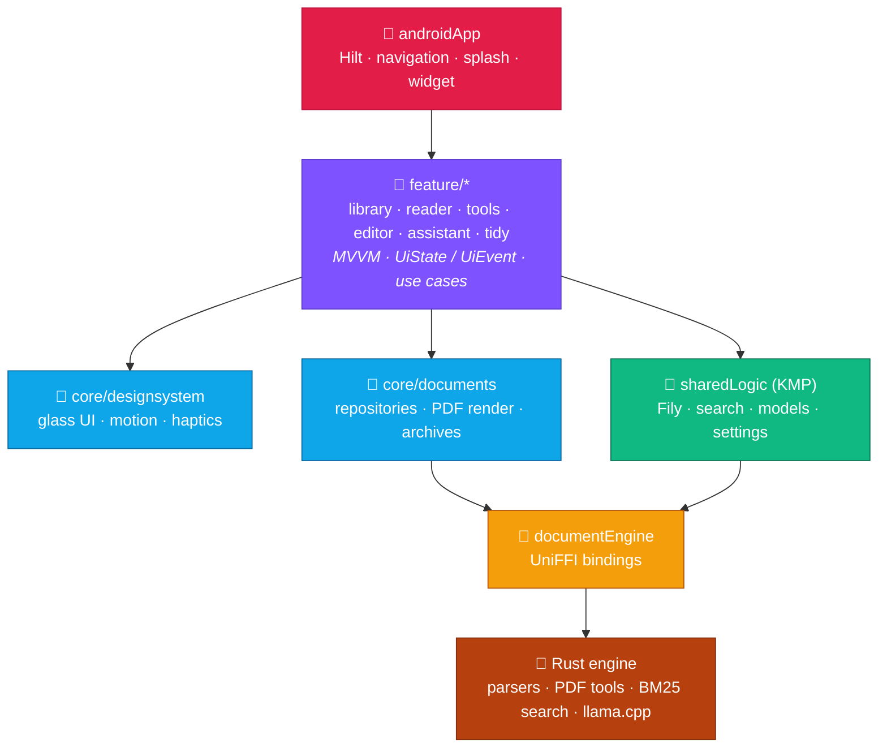

<div align="center">


# Xfiles

### ✨ Premium feel. Faster app. ✨

**Every file, beautifully handled, all on your phone.**
PDFs, Office, EPUB, media and archives, plus **Fily** 🤖, an AI assistant that lives on your device.

<p>
  <a href="https://github.com/kishore-bot/X-Files/releases"></a>
  <a href="LICENSE"></a>
  
</p>
<p>
  
  
  
  
  
  
</p>

[⬇️ Download](#get-it) · [🌟 Features](#features) · [🤖 Fily](#fily) · [🏗️ Architecture](#architecture) · [🛠️ Build](#build) · [🤝 Contribute](#contributing)

</div>

---

## 💎 Highlights

| ⚡ **Fast** | 🔒 **Private** | 🎨 **Premium** | 🤖 **Smart** |
|:---:|:---:|:---:|:---:|
| A native Rust engine parses, searches and edits | Offline-first: documents never leave the device | Glass UI, motion and haptics, Material 3 | Fily answers and acts, fully on-device |

---

<a name="get-it"></a>

## ⬇️ Get it

Grab the latest signed APK from **[Releases](https://github.com/kishore-bot/X-Files/releases)**. Each release has an `Xfiles-<version>.apk` and its `.sha256` checksum.

> 🧪 Xfiles is in **beta** (`1.0.0-beta.xx`). Releases are built, tested and signed automatically by GitHub Actions.

---

<a name="features"></a>

## 🌟 Features

### 📖 Reading

| | Format | Highlights |
|---|---|---|
| 📕 | **PDF** | Continuous scrolling, thumbnails, zoom, single, two-up and grid views; find; annotations (pen, highlight, notes, signatures); text selection, also on scans through OCR; **digital signature details** |
| 📘 | **Word · Excel · PowerPoint** | DOCX, XLSX and PPTX (plus ODF and legacy DOC/XLS/PPT); tables as one grid; find & replace; cell editing with frozen panes; slides with **links, audio and video**; presenter |
| 📗 | **EPUB** | **Paged or scroll** reading; contents and notebook; highlights and notes; footnotes; working links; themes (White, Sepia, Green, Dark, Black), fonts and justified text |
| 📝 | **Text · Code · JSON · HTML · SVG** | Syntax highlighting with expand/collapse all; JSON tree and pretty print; working web links; SVG preview and source; text size |
| 🖼️ | **Pictures** | Swipeable folder gallery, sharp tiled zoom, animated images, EXIF |
| 🎬 | **Video · Audio** | Picture-in-picture; gestures; speed control; audio-track switching; subtitles (SRT, VTT, ASS) with styling; AC3, DTS and TrueHD through FFmpeg |
| 🗜️ | **ZIP** | Browse, extract, compress, and open ZipCrypto or AES-encrypted entries |

🎨 **Page style** shows any document in **Original**, **Standard**, **Dark** or **Sepia**.

💡 **At a glance** summarises any file and makes its dates, amounts, phone numbers and links tappable.

### 🧰 Tools

- 📄 **PDF:** merge, split, reorder, rotate, compress, watermark, sign, and password protect or unlock (AES-256).
- 🔁 **Convert:** pictures ⇄ PDF, PDF → text, PDF → ZIP, and text → PDF with templates.
- 📷 **Scanner:** corner adjustment, filters, and searchable (OCR) PDFs.
- 🗜️ **Zip tools:** compress to ZIP and extract, with progress.
- 🧹 **Tidy up:** finds duplicate and unneeded files.

Every tool follows the same visual flow: **Pick → Adjust → Save**, with live previews.

### 📚 Library

- Recent files ranked by **frecency**, plus bookmarks, 12 type filters and typo-tolerant search with full-text search inside documents.
- Multi-select, a home-screen widget, app shortcuts, **Open with** / **Share to** for 40+ types, and **Save to Downloads** for files opened from other apps.

---

<a name="fily"></a>

## 🤖 Fily: the on-device assistant


Fily is a voice assistant running a **350M-parameter model locally** through llama.cpp. It answers questions about your files, with page citations, and drives the app through 45 tools: open documents, run PDF tools, scroll and turn pages, tidy storage and more. It speaks its answers back on-device. Voice input requires an on-device recognizer on Android 12 or later. Spoken replies require an installed offline TTS voice.

| 🧠 Technique | 🎯 Why | ⚙️ How |
|---|---|---|
| **RAG** | A long PDF won't fit a 4K-token context | Passages of about 250 tokens, indexed with **BM25** in Rust, de-duplicated with MMR and labelled `[page N]` |
| **KV-cache reuse** | Re-reading the long system prompt costs seconds | The context stays alive, and only the new suffix is decoded |
| **GPU crash guard** | Some GPU drivers crash while loading models | A persisted state machine falls back to the CPU |
| **Quick commands** | Instant screen control, no model round-trip | "Scroll down the page" or "next slide" act at once |
| **Prompt contract test** | A retrained model must see the prompt it was trained on | The app's prompt is tested against training fixtures |

The model downloads once, on request, from this repository's `models-v1` release. Training scripts are in [`training/`](training/README.md).

<details>
<summary>🔌 <b>MCP server: the engine as AI tools</b></summary>

[`engine/crates/xfiles-mcp`](engine/crates/xfiles-mcp) is a **Model Context Protocol** server, built on the official Rust SDK `rmcp`. It gives desktop AI clients such as Claude Desktop and Claude Code the same document engine the app uses, with 13 tools for reading, PDF, Office find & replace and ZIP. Access is sandboxed to the `--root` directories you pass, inputs are never modified, outputs are written atomically, and there's no network access.

```bash
cargo build --release --manifest-path engine/Cargo.toml -p xfiles-mcp
claude mcp add xfiles -- /path/to/xfiles-mcp --root ~/Documents
```
</details>

---

<a name="architecture"></a>

## 🏗️ Architecture



**Stack:**
- **Kotlin 2.4**, Compose BOM 2026.11 with Material 3, Hilt, Coroutines/Flow, Navigation 3, Media3, CameraX, ML Kit and WorkManager.
- **Rust** with UniFFI, llama.cpp and FFmpeg 7.1.
- **AGP 9.5** with R8 full mode and baseline profiles.

---

## 🔒 Privacy

- 📴 **Offline-first:** documents, file names and Fily conversations never leave the phone.
- 🌐 **Internet is used only for:**
  - the one-time Fily model download, when you ask for it;
  - opt-in crash reports;
  - feedback you choose to send.
- 🗑️ **No backups:** uninstalling removes all app data.

---

<a name="build"></a>

## 🛠️ Build from source

**Requirements:** Linux or WSL, JDK 17, Android SDK (compile SDK 37), NDK `29.0.14206865`, Rust (see `rust-toolchain.toml`) and CMake.

```bash
ANDROID_HOME=~/Android/Sdk bash scripts/build-ffmpeg.sh   # optional: FFmpeg audio decoders (LGPL)
./gradlew :androidApp:assembleDevDebug                     # dev build (com.xfiles.dev)
./gradlew :androidApp:assembleProdRelease                  # release build, R8-minified
```

The reader depends on `dev.lazymatrix:lazymatrix:0.1.1`. Gradle finds the Maven
publication at `../../CustomCompose/LazyMatrix/lazymatrix/build/maven` relative to
Xfiles. Use `-PlazyMatrixLocalRepo=/path/to/lazymatrix/build/maven` for a different
local checkout.

Clean checkouts resolve the same version from GitHub Packages. Publish the AAR,
POM, and Gradle module metadata to the private LazyMatrix Maven registry and give
Xfiles Actions read access to the package. If the workflow token cannot access
the private repository, set the `LAZYMATRIX_MAVEN_USER` repository variable and the
`LAZYMATRIX_MAVEN_TOKEN` Actions secret for an account with package read access.
Use `-PlazyMatrixMavenUrl=https://…` to use another hosted Maven repository.

### 🧪 Tests

```bash
./gradlew :sharedLogic:testAndroidHostTest                # Kotlin domain tests
cargo test --manifest-path engine/Cargo.toml --workspace  # Rust engine and MCP server
```

### 🚀 Releasing

1. Bump `xfiles.version` in `gradle.properties` (for example `1.0.0-beta.03`) and commit.
2. Push the matching tag: `git tag v1.0.0-beta.03 && git push origin v1.0.0-beta.03`.

GitHub Actions then builds, tests, signs and publishes the APK.

---

<a name="contributing"></a>

## 🤝 Contributing

Contributions are welcome! 💜 Read **[CONTRIBUTING.md](CONTRIBUTING.md)** first. It covers:
- **architecture:** MVVM with unidirectional data flow, use cases, and the Rust engine;
- **performance rules;**
- **the current stack.**

Please follow the [code of conduct](CODE_OF_CONDUCT.md), and report security issues privately as described in [SECURITY.md](SECURITY.md).

---

## 📜 Licence

Xfiles is licensed under the **[Apache License 2.0](LICENSE)**. See [NOTICE](NOTICE) for third-party components:
- **FFmpeg** is used under the LGPL 2.1+, as separate replaceable shared libraries.
- **The Fily model** is downloaded separately and governed by its base model's licence.
