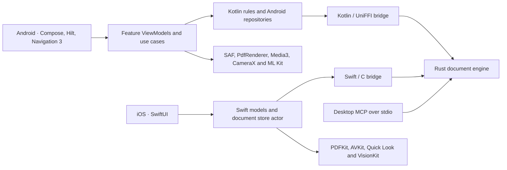

<div align="center">


# Xfiles

An offline-first file library, reader, editor, and media player for Android, iPhone, and iPad.

[Download](#get-it) · [Features](#features) · [iPhone and iPad](#ios) · [Fily and AI](AI.md) · [Architecture](#architecture) · [Build](#build)

</div>

## Get it

Android 11 and later. The signed APK supports `arm64-v8a` and `x86_64`. The current source version is set in [gradle.properties](gradle.properties).

[Download beta.09](https://github.com/kishore-bot/X-Files/releases/download/v1.0.0-beta.09/Xfiles-1.0.0-beta.09.apk) · [SHA-256 checksum](https://github.com/kishore-bot/X-Files/releases/download/v1.0.0-beta.09/Xfiles-1.0.0-beta.09.apk.sha256) · [All Android releases](https://github.com/kishore-bot/X-Files/releases)

<a id="features"></a>

## Android features

- **Library.** Open or share files into Xfiles, or link folders through Android's storage picker. Filter by file type, bookmark files, share a selection, and search filenames or indexed text. PDF search results can open at the matching page. Recent files use frequency and recency. The Images tab restores and marks the last viewed image, and video history shows playback progress.
- **Readers.** Reopen supported files at the saved page, offset, sheet, slide, or timestamp. Media reopens paused. Top-bar controls reflect the active format. Reading appearance, text size, and other options depend on the viewer. Xfiles includes a launcher widget and file shortcuts.
- **PDF.** Use continuous, single-page, two-page, or thumbnail views. Zoomed pages can render higher-detail content. Native text search and selection depend on Android PDF API availability. Bundled Latin-script OCR covers supported scans and older devices with approximate highlights. Add pen, highlight, note or drawn signature annotations when the file can be edited. Signature details describe the PDF's declared signature. Cryptographic trust verification is outside this feature.
- **Books and Office.** EPUB supports paged and continuous reading, chapter progress, themes, footnotes, and a notebook for bookmarks, highlights, and notes. Workbook viewing includes frozen rows and columns. Supported edits create a separate file. Layout fidelity, cached formulas, slide animations, and embedded media depend on the file and renderer. Office macros and EPUB scripts are disabled.
- **Images and video.** Browse a folder gallery and use tiled image zoom for supported files. The video player offers PiP, speed and track controls, pinch zoom, side double-tap seeking, center double-tap play/pause, and seek previews on horizontal drags. External SRT and WebVTT timing can shift earlier or later per video.
- **Tools.** Merge, split, reorder, rotate, compress, watermark and protect PDFs. Convert images or text to PDF or export PDF pages, text, or ZIP. Scan with corner adjustment, filters and optional OCR. Tidy groups exact duplicates and similar content for review. Archive tools create and extract ZIP, TAR, TAR.GZ, and 7z. Password-protected ZIP creation uses WinZip-compatible AES-256 and leaves entry names visible.

## Supported files

Common extensions are listed here. Device decoders, document protection, and format variants affect what each viewer can open. The training domain builder reads the first two columns.

| Format | Extensions | Reader notes |
| --- | --- | --- |
| PDF | `.pdf` | Protected file opening and native text features depend on Android APIs. |
| Word | `.docx` `.docm` `.dotx` `.dotm` `.doc` | Page or reading layout for supported documents. |
| Excel | `.xlsx` `.xlsm` `.xltx` `.xltm` `.xls` | Stored values and formatting. XLSX supports Save As edits. |
| PowerPoint | `.pptx` `.pptm` `.ppsx` `.ppsm` `.potx` `.potm` `.ppt` | Slides, notes and supported links and media. |
| OpenDocument | `.odt` `.ods` `.odp` | Text documents, sheets and presentations. |
| EPUB | `.epub` | Reflowable and fixed-layout books. DRM-protected books are unsupported. |
| Markdown | `.md` `.markdown` `.mdown` `.mkd` `.mdx` | Preview and numbered source. |
| HTML and SVG | `.html` `.htm` `.svg` | Local preview with restricted document content. |
| CSV / TSV | `.csv` `.tsv` `.tab` | Grid and source views. |
| JSON | `.json` `.geojson` `.jsonc` `.webmanifest` | Structured preview and source. |
| Code and config | `.kt` `.java` `.rs` `.py` `.js` `.ts` `.swift` `.go` `.c` `.cpp` `.sql` `.sh` `.xml` `.yaml` `.yml` `.toml` `.ini` `.css` `.diff` `.patch` `.jsonl` | Bounded syntax highlighting and plain-text editing. |
| Plain text | `.txt` `.log` | UTF-8 and UTF-16 with a byte-order mark. |
| Images | `.jpg` `.jpeg` `.png` `.webp` `.gif` `.bmp` `.heic` `.heif` `.avif` | Supported formats vary by Android version. |
| Audio and video | `.mp4` `.m4v` `.mov` `.3gp` `.webm` `.mkv` `.mp3` `.m4a` `.aac` `.wav` `.ogg` `.opus` `.flac` `.amr` `.mid` | Container detection and track decoding are separate. |
| ZIP | `.zip` | Standard ZIP and supported ZipCrypto or AES-encrypted entries. |
| TAR and 7z | `.tar` `.tar.gz` `.tgz` `.7z` | Extraction limits apply. New 7z files use non-solid LZMA2. |

<a id="ios"></a>

## iPhone and iPad

The native SwiftUI app targets iOS and iPadOS 17 or later. Import files from Files or open them in Xfiles to keep an owned local copy. The library provides search, bookmarks, recents, document tools, scanning, and duplicate detection. Readers include PDFKit, paged and continuous EPUB, structured Office and spreadsheet views, local media, image preview and archives. Quick Look covers eligible additional formats. Edited or extracted files can publish as separate copies.

AVKit handles native playback. Choose **Use compatibility playback** for a supported local container or audio track that AVKit cannot handle. MPVKit provides compatibility playback and its own seek, language, and subtitle controls. Apple Foundation Models and voice capabilities have separate OS, device, and permission requirements. See the [AI guide](AI.md) for fallback behavior.

The iOS implementation is available in source. Distribution, signing, and physical-device acceptance are separate release checks.

<a id="fily"></a>

## Fily

Fily searches authorized files, answers with source excerpts, and controls supported readers. Android uses a downloadable on-device model. iOS can use Apple Foundation Models when available. The [AI guide](AI.md) covers local retrieval, permissions, training, evaluation, and the desktop MCP server.

## Architecture

### High-level design



| Area | Source |
| --- | --- |
| Android app shell, navigation, launch and integrations | [androidApp](androidApp) |
| Android feature UI and workflows | [feature](feature) |
| Reusable UI, accessibility, motion, and haptics | [core/designsystem](core/designsystem) |
| Android storage, rendering, staging, and publishing | [core/documents](core/documents) |
| Kotlin Multiplatform rules and Android native adapter | [sharedLogic](sharedLogic), [documentEngine](documentEngine) |
| iOS shell, readers, and adapters | [iosApp/Xfiles](iosApp/Xfiles) |
| Rust parsers, search, editing, archives, and FFI | [engine/crates](engine/crates) |
| Android software audio fallback | [ffmpeg](ffmpeg), [build script](scripts/build-ffmpeg.sh) |

### Low-level design

| Boundary | Ownership |
| --- | --- |
| Android UI | Compose renders immutable state from feature ViewModels. Use cases handle reusable workflows. Reader controllers scope PDF rendering, scroll state and asynchronous results to the open document. LazyMatrix owns the sheet grid viewport and frozen panes. |
| iOS UI and storage | SwiftUI and main-actor models drive the UI. The document store actor holds security-scoped access for imports and publishes a local copy and metadata. Readers persist a PDF page, text offset, structured location or playback timestamp. EPUB can store an offset within the block for repagination. |
| Native bridge | OxiKT generates Kotlin bindings for the UniFFI library. Xcode builds the Rust static library and Swift sends bounded JSON requests through a C interface. Keep generated types, descriptor ownership, cancellation and native allocation release inside the adapters. |
| Search and storage | Android traverses user-linked SAF folders and reconciles permissions and missing sources. iOS indexes owned files. Rust uses a local BM25 posting index and returns snippets and page references where available. |
| Exports and archives | Stage transforms privately and publish completed outputs through the platform repository. Archive extraction uses relative paths and rejects unsafe destinations. Supported extraction is bounded to 512 MiB per file, 2 GiB selected and 20,000 entries. ZIP64/split ZIP and passworded 7z are current limits. |
| Player | Android uses MediaCodec by default, with FFmpeg audio fallback where packaged. Eligible audio failures can retry with FFmpeg preferred. Signaled HDR uses a SurfaceView. Android audio boost, SDR adjustment and USB mixer preferences depend on the route and playback mode. iOS uses AVKit and MPVKit. |
| Audio, color and subtitles | HDR signaling and advertised display modes are diagnostic. The device, stream and route determine the result. Source losslessness and output quality are separate. Android reports compatible USB mixer preference or spatial availability when available, and iOS reports session route and sample rate. External subtitle overlays use Rust-parsed cues and the player clock. Embedded-track timing stays with the player. |

## Privacy and reporting

Reading, indexing, document conversion, and Fily inference run locally. Android access comes from files and folders you choose. iOS imports private copies. Sharing and printing open system flows for you to complete. Android can use a network connection for an explicitly requested model download and for reporting when configured.

Firebase-enabled Android builds send suggestions and crash reports directly to Cloud Firestore. **Feedback** writes to `feedback` when you tap Send. **Crash reports** write to `crash_reports` when sent from the preview or on the next launch after a crash if automatic reporting is enabled. Automatic reporting starts off. Reports include technical metadata and stack frames. Exception messages are omitted. The local recorder covers uncaught Java and Kotlin exceptions. Failed crash submissions remain available for retry. Feedback can queue through Firestore.

Maintainers register `com.xfiles` in Firebase, enable Firestore, and place the ignored `google-services.json` in `androidApp/` for local production builds. The `xfiles.firebaseCrashReports` Gradle property controls the integration. CI uses `XFILES_GOOGLE_SERVICES_JSON_BASE64`. Dev or unconfigured builds have no Firestore sender. Deploy the [checked-in rules](firebase/firestore.rules) with the Firebase CLI from `firebase/`.

```sh
firebase deploy --project <project-id> --only firestore:rules
```

The rules validate creates and deny client reads, updates and deletes. Inspect submissions in the Firebase console. App Check, quotas and retention are deployment responsibilities.

<a id="build"></a>

## Build from source

### Android

Use Linux or WSL, JDK 17, Android SDK 37, the configured NDK and CMake, and the pinned Rust toolchain. See the [version catalog](gradle/libs.versions.toml), [Rust toolchain](rust-toolchain.toml) and [release workflow](.github/workflows/release.yml) for exact pins.

```sh
ANDROID_HOME=~/Android/Sdk bash scripts/build-ffmpeg.sh
./gradlew :androidApp:assembleDevDebug
./gradlew :androidApp:assembleProdRelease
```

The spreadsheet reader uses `dev.lazymatrix:lazymatrix:0.1.2`. Provide the Maven publication at `../../CustomCompose/LazyMatrix/lazymatrix/build/maven` relative to Xfiles, or set `-PlazyMatrixLocalRepo=/path/to/lazymatrix/build/maven`. For hosted Maven, use `-PlazyMatrixMavenUrl` and the `LAZYMATRIX_MAVEN_USER` and `LAZYMATRIX_MAVEN_TOKEN` environment variables. GitHub Actions obtains the pinned AAR, POM, and module metadata from the private artifact repository with the read-only `LAZYMATRIX_MAVEN_SSH_KEY`.

### iOS

Use macOS and Xcode with Swift 6 and an iOS 26 or newer SDK for Foundation Models. Install the destinations you use. Add `x86_64-apple-ios` for Intel simulators.

```sh
rustup target add --toolchain 1.100.0 aarch64-apple-ios aarch64-apple-ios-sim
open iosApp/Xfiles.xcodeproj
```

Select the shared **Xfiles** scheme. The build compiles the Rust engine for the selected destination and resolves the pinned MPVKit package. Set the team and bundle identifier under **Signing & Capabilities** for a physical device.

### Checks and release

```sh
./gradlew :sharedLogic:testAndroidHostTest
cargo test --manifest-path engine/Cargo.toml --workspace
```

When preparing an Android release, bump `xfiles.version` and push a matching `v<version>` tag or dispatch the release workflow with the version. The workflow uses `XFILES_KEYSTORE_BASE64`, `XFILES_KEYSTORE_PASSWORD`, `XFILES_KEY_ALIAS` and `XFILES_KEY_PASSWORD` to sign and publish. CI checks the FFmpeg libraries and alignment for both ABIs in the Dev Debug and signed APKs. The workflow files describe the CI variants and trusted artifact access. [PR check](.github/workflows/pr-check.yml) · [CodeQL](.github/workflows/codeql.yml) · [Release](.github/workflows/release.yml)

## Performance and acceptance

- Keep provider reads and native work off the UI thread. Scope concurrent work and caches to the owning operation or document revision. Bound decoder work, intermediate buffers, native bitmap memory, and background queues. Publish only current results and release handles when the owning job exits.
- Use [Baseline Profiles](baselineprofile) and device traces for cold and warm startup, PDF first render and scroll, folder scans, query latency during indexing, frozen sheet scrolling, and video seek-to-frame. Measure p95 latency, frame timing and peak memory on identical files and devices. Measure I/O, queue delay and native work before changing storage or concurrency.
- Validate archives with both apps and desktop tools, including Unicode names, wrong passwords, cancellation, path safety, and low storage. Verify subtitle timing after seek, pause, speed and track changes on Media3, AVKit and MPVKit.
- For media, cover Snapdragon, Dimensity, Exynos, Tensor, entry-level Android hardware, and the x86_64 emulator. Include older and newer iPhones and an M-series iPad. Check every language track in a multilingual fixture, HDR and SDR displays, wired and wireless routes, spatial availability and USB DAC transitions. A rate or mixer match in the UI is capability evidence. End-to-end bit-perfect output requires measurement.
- Include light and dark themes, landscape, small screens, large fonts, TalkBack, VoiceOver, and reduced motion in UI acceptance. Check PDF controls during a fling, resume after restart, cancellation of an export, and deletion or revocation of a linked folder.

## Contributing

Keep pull requests focused. Follow each feature's existing state and use-case boundaries, keep heavy work off the UI thread, and use the shared theme and motion components. Include changed-logic tests, screenshots for UI changes, and measurements for performance-sensitive changes. Use the PR template and keep keys, service configuration and model weights out of Git.

Xfiles follows the [Contributor Covenant 2.1](https://www.contributor-covenant.org/version/2/1/code_of_conduct/). Treat contributors respectfully and report conduct concerns privately to a maintainer through GitHub. Maintainers handle reports confidentially and may moderate contributions or restrict participation.

## Reporting a vulnerability

Use GitHub's **Report a vulnerability** action on the repository Security tab, or contact a maintainer privately through GitHub if the action is unavailable. Include the version or commit, reproduction details, a safe fixture if available, and the likely impact. Use private reporting for crafted-file vulnerabilities, unauthorized file access, or Fily confirmation bypasses. Xfiles aims to acknowledge reports within seven days. The latest release and `dev-deploy` receive fixes.

## License

Xfiles uses the [Apache License 2.0](LICENSE). Contributions are licensed under the same terms. The [NOTICE](NOTICE) describes third-party components, including FFmpeg under LGPL 2.1+. Downloadable model weights are subject to their own license terms.
