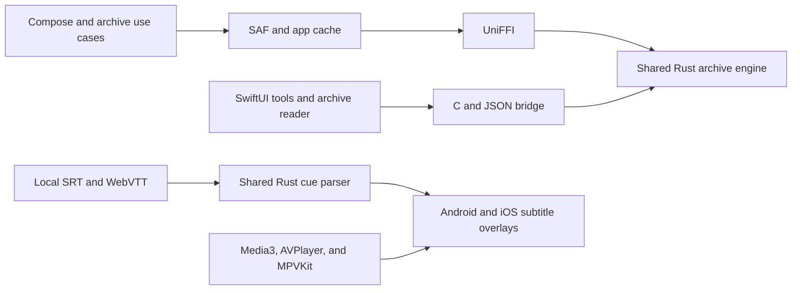

# Archives and external subtitle timing

## High-level design

Android keeps the Compose screen, ViewModel, use case, SAF repository, and UniFFI boundaries. iOS keeps the SwiftUI tools and readers, owned library files, and cancellable Swift-to-Rust bridge. Both use the existing Rust archive session and parser crate. The platform players still own decoding, playback, and the media clock. The Rust engine parses external subtitle cues, and the platform overlays render them.

## Low-level design

| Boundary | Behavior |
| --- | --- |
| Archive creation | A native job accepts selected files and folders, the output format, and a ZIP-only password. The writer finalizes a private output before publication. ZIP uses the WinZip AES-256 extension when protected. TAR bundles entries, TAR.GZ wraps the stream in gzip, and 7z uses non-solid LZMA2 output. Entry names stay visible in protected ZIPs. |
| Android storage | SAF files are staged into the private cache. The coroutine cancellation path signals the native job and waits before releasing it. Progress comes from atomic counters. The app deletes its temporary files and attempts to delete incomplete provider output on failure. Pipes supplied by document providers are copied to seekable cache files. |
| iOS storage | The existing SwiftUI tool writes to a job-specific temp directory. It can read a folder while holding its Files security scope. Success imports the archive into the library. ArchiveReader can export selected entries or the whole result to Files. |
| Archive reading | The existing ZIP reader retains password and CRC handling. TAR and 7z implement the same entry and extraction contract. Extracted paths are relative and staged before export. TAR rejects unsafe paths, skips links and special files, and caps extended metadata. 7z uses a 64 MiB decoder limit. Current limits are 512 MiB per extracted file, 2 GiB of selected contents, and 20,000 entries. |
| Subtitle timing | Rust parses a bounded external SRT or WebVTT sidecar into sorted cues. Android consumes the timeline when the associated Media3 track is selected. iOS uses one timeline with either AVPlayer or MPVKit. Each overlay finds the cue at media position minus the signed offset, preserving cue duration and handling overlapping lines. |
| Playback settings | The offset persists per video, from −5 to +5 seconds in 250 ms steps. The timing UI is available for parsed external text tracks. Embedded subtitle timing remains with the player. MPVKit's pinned public interface offers track selection without a delay setter, so the compatibility path uses the external text overlay. |

Current limits include ZIP64 and split ZIP input, passworded 7z, TAR sparse files and PAX size overrides, and embedded-track offsets. External overlays render text and preserve line breaks. Rich WebVTT positioning and styling stay with the native renderer where available.

## Release checks

- Create all four archive formats on Android and iOS. Open an AES-256 ZIP with Xfiles and desktop 7-Zip. Verify wrong passwords, Unicode names, nested and empty directories, and cancellation while writing and publishing.
- Cross-check TAR against desktop `tar` and 7z against desktop 7-Zip. Measure solid 7z selective extraction and cancellation. Verify failed extraction leaves the chosen destination free of partial files.
- Use a cue from 10 to 12 seconds and verify it appears from 8 to 10 seconds at a −2-second offset. Cover playback speed, pause, seek, track changes, and reopen on Media3, AVPlayer, and MPVKit.
