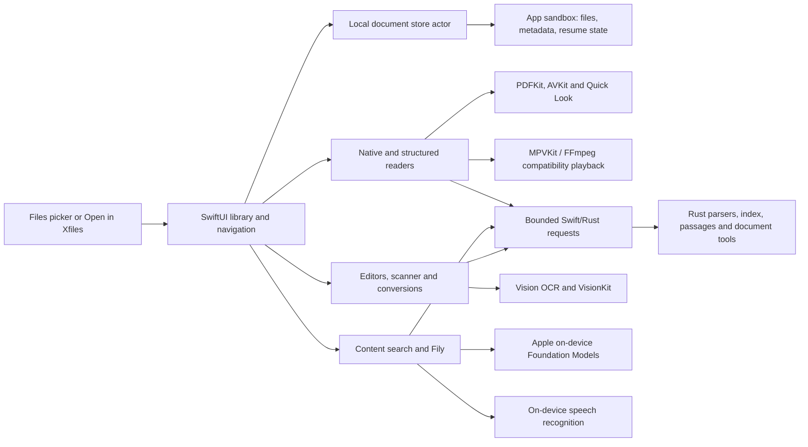

# Xfiles for iPhone and iPad

## High-level design

Xfiles for iOS uses SwiftUI and Swift 6 language mode with an iOS and iPadOS 17 deployment target. Platform UI, playback, camera, speech, and AI are hosted by the iOS target. Structured parsing and the document operations already available in Rust are shared with Android. The app keeps its own imported copies and works offline after import.

## Low-level design

| Boundary | Ownership and behavior |
| --- | --- |
| Library | SwiftUI owns navigation and presentation. The main-actor library model publishes file metadata, bookmarks, recents, and import state. The store actor holds security-scoped access during coordinated imports and atomically publishes the owned copy and metadata. |
| Bridge | Xcode builds the existing `document-ffi` static library for the active destination. Swift uses a C header to send JSON requests to an iOS-only Rust adapter. Each request runs off the main actor, owns a cancellation job, and releases Rust allocations at the boundary. The Android UniFFI API remains available. |
| Readers | PDFKit, AVKit, and a UIKit text surface handle the native reader paths. The Rust adapter sends a bounded structured preview for Office, EPUB, spreadsheets, and slides. EPUB uses chapter starts, inline styles, links, footnotes, and a Core Text page layout for the active chapter. Its notebook persists bookmarks, notes, and highlights in a separate per-book JSON file. Sheets can freeze the first row and column. Slides use the engine’s shape geometry and embedded resources. Quick Look handles formats outside these reader paths when supported. |
| Position | Persist PDF page, text offset, playback timestamp, or structured section and block. EPUB paged mode also stores the UTF-16 offset within a block, so page size changes can relocate the reading position. Save while reading and flush on departure or backgrounding. Resume media paused. |
| Search | The store gives the Rust index only owned library files. Rust serializes index writes, removes stale entries on search, and returns snippets with the PDF page whenever available. Filename search remains available independently. |
| Fily | Library retrieval uses the local index. Open-document questions may also use the Rust hybrid passage cache. Answers use the local Foundation Models provider when iOS 26+ and the device make it available. Sources and deterministic commands work independently. Readers register their capabilities with the command router. It routes controls to the active viewer and opens existing tool screens for user review. The model receives excerpts and has no file-action tool authority. Dictation requires the on-device speech route and user permission. |
| Editing and tools | Text and document edits generate separate files in temporary storage. Rust handles PDF rewrites, markup, watermarking and drawn signatures, Office replacement, XLSX cell editing, PPTX ordering, and archive creation and extraction. Platform tools handle scan capture, OCR, text/images to PDF, and duplicate detection. Successful outputs are published to the library under new IDs. |
| Playback | AVKit is the primary backend. On an AVKit rejection, or when the user selects compatibility playback, MPVKit opens supported local media containers using libmpv and FFmpeg. Transfer timestamp and playback intent between engines. Both paths can render timed external SRT and WebVTT cues. See the [media playback design](MEDIA_PLAYBACK_DESIGN.md) for track diagnostics and hardware validation. Reject playlist signatures at the fallback boundary. |
| Accessibility | Use native controls, support VoiceOver and system gestures, and respect Reduce Motion for library transitions. Platform features expose unavailable states. |

## Implementation and validation plan

| Step | Status |
| --- | --- |
| App structure and library | Implemented in source. Validate import from Files providers, large files, app restart, and two iPad windows. |
| Rust bridge and document readers | Implemented in source. Verify linking on device and simulator, EPUB chapter paging, notebook persistence and rotation, pinned panes, slideshow links, password handling, and media resources. |
| Full-text search and offline Fily | Implemented in source. Check PDF citation jumps, concurrent searches, stale entries, model availability, offline dictation, and reader and tool action routing. |
| Editing and conversion | Implemented in source. Check that inputs stay byte-for-byte unchanged, verify generated PDFs and ZIPs, and validate scanner OCR on an iPhone or iPad. |
| Decoder fallback | Implemented in source. Verify Xcode package resolution and test E-AC-3 MKV with several languages, seeking, subtitle changes, and a native-to-compatibility handoff. |
| Xcode build, signing and device approval | Pending macOS, Xcode, and explicit build or test authorization. The shared Xfiles scheme is configured for this step. |

### Current platform limits

- Office previews are Xfiles renderings of the parsed content. Pixel-level fidelity, spreadsheet formula recalculation, and desktop Office editing are outside the current reader.
- EPUB notebook highlights apply to a passage or page fragment. EPUB pagination depends on the viewport and text size. Large illustrations and tables can scroll within a page.
- Compatibility playback supports local containers recognized at import and at the file-signature boundary. AVKit and MPVKit expose different hardware, HDR, spatial, and system playback capabilities.
- The archive reader covers ZIP, TAR, TAR.GZ, and 7z. It can import an individual file into Xfiles or export a selection to Files. See the [archive and subtitle design](ARCHIVE_AND_SUBTITLE_DESIGN.md) for limits and release checks. Duplicate detection compares exact content.
- Content search is based on text that the engine can extract. Password-protected files are not indexed, and scanned documents need an OCR text layer to participate.
- The iOS Fily provider is Apple's on-device model. It uses the iOS capability registry for reader commands and opens editing tools for review. Android's GGUF backend and Android-specific platform actions remain separate. Availability of the model, dictation, and voices depends on the device and configuration.

### Primary references

- [Apple WWDC26 iOS guide](https://developer.apple.com/wwdc26/guides/ios)
- [SwiftUI Observation](https://developer.apple.com/documentation/swiftui/migrating-from-the-observable-object-protocol-to-the-observable-macro)
- [PDFKit](https://developer.apple.com/documentation/pdfkit) · [AVKit](https://developer.apple.com/documentation/avkit) · [Quick Look](https://developer.apple.com/documentation/quicklook)
- [VisionKit document scanner](https://developer.apple.com/documentation/visionkit/vndocumentcameraviewcontroller)
- [Foundation Models](https://developer.apple.com/documentation/foundationmodels/systemlanguagemodel)
- [MPVKit v0.1.0](https://github.com/zinoio/MPVKit/releases/tag/v0.1.0)
- [On-device speech recognition](https://developer.apple.com/documentation/speech/sfspeechrecognitionrequest/requiresondevicerecognition)
