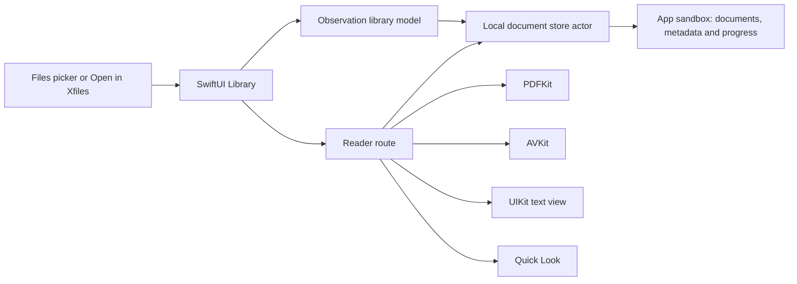

# Xfiles for iPhone and iPad

## High-level design

Build a native SwiftUI app with one iOS target, a Swift 6 language mode, and an iOS/iPadOS 17 deployment target. The 2026 Apple guidance informs the architecture. Stable system APIs keep the first version installable on older devices. The app runs offline after import and uses system viewers where they fit. Android keeps its existing Gradle targets.

The first delivery covers import, library organization, search by filename, system previews, sharing, and reopen position. iOS and Android use independent libraries on their respective devices. Existing Rust parsers and BM25 search are candidates for reuse through UniFFI. The shared Kotlin module currently has no Apple target, and the Android Compose grids are Android UI.

## Low-level design

| Boundary | Ownership and behavior |
| --- | --- |
| App | The SwiftUI scene owns navigation. The library model is isolated to the main actor and shared by app windows. The appearance preference uses AppStorage. |
| Import | File importer accepts regular files. Hold security-scoped access while a coordinated copy reads the provider file. Publish a UUID directory only after its staged copy and metadata exist. Original URLs and permission tokens are transient. |
| Store | An actor serializes filesystem access. Each document directory stores its original file name under `payload` and a versioned JSON record. Metadata updates use atomic replacement. Missing payloads disappear from the index. Imports and deletes leave recoverable staging directories if interrupted. |
| Library | Filter the local records by file kind, bookmark status, and last-opened date. Filename searches operate on metadata. Last-opened and bookmark changes go through the same store. |
| Reader | The stored kind selects PDFKit, AVKit, a selectable text surface, or Quick Look. The reader shares the owned file through the system share sheet. Unsupported formats surface an error or a Quick Look fallback. |
| Position | PDF stores a zero-based page, text stores its vertical offset, and AVKit stores seconds. Keep the latest in memory, checkpoint changes, and flush on leaving the reader or backgrounding. Reopen media paused and clamp the seek to its duration. Images and other system previews are tracked in Recents. |
| Accessibility | Use system navigation, searchable lists, scalable reader text, and native controls. Custom Library animations observe Reduce Motion. |

## Implementation and validation plan

| Step | Completion |
| --- | --- |
| 1. Research Apple’s 2026 Swift and iOS guidance and inspect Android/Rust boundaries | Done. Sources and integration decisions are recorded here. |
| 2. Add the standalone SwiftUI app and Xcode scheme | Implemented under `iosApp`. Apple SDK verification pending. |
| 3. Implement file import, durable storage, filters, bookmarks, recents, and share | Implemented. Verify on-device provider permissions, empty or deleted entries, large imports, and an interrupted import. |
| 4. Wire PDF, text, image/Quick Look, and video/audio previews with resume | Implemented. Verify relaunch position, locked PDFs, unsupported media, and format behavior on device. |
| 5. Add appearance controls and native accessibility behavior | Implemented. Verify light and dark appearance, VoiceOver, Dynamic Type, Reduce Motion, and iPad resizing. |
| 6. Build, sign, and validate the delivery | Pending macOS, Xcode, and explicit build/test authorization. Use the shared Xfiles scheme. Provisioning and distribution are separate from building for the simulator. |

### Android parity after the first delivery

1. Package the existing `document-ffi` Rust static library for device and simulator and generate Swift UniFFI bindings. Validate the Swift boundary against existing parser fixtures before routing Office, EPUB, spreadsheets, and archives to custom viewers. Keep the native previews as the baseline.
2. Expose the Rust document-search API to Swift for passage retrieval and citations. Keep filename search available during indexing. Revisit store indexing based on measured library size.
3. Add an offline Fily provider after defining iOS action capabilities. Evaluate on-device model availability and keep reader commands local even when the model is unavailable.
4. Add Android-specific feature equivalents only after recording the iOS route and OS capabilities for playback, HDR, spatial audio, annotations, and document editing.

### Primary references

- [Apple WWDC26 iOS guide](https://developer.apple.com/wwdc26/guides/ios)
- [What’s new in Swift](https://developer.apple.com/videos/play/wwdc2026/262/)
- [What’s new in SwiftUI](https://developer.apple.com/videos/play/wwdc2026/269/)
- [SwiftUI Observation](https://developer.apple.com/documentation/swiftui/migrating-from-the-observable-object-protocol-to-the-observable-macro)
- [SwiftUI file importer](https://developer.apple.com/documentation/swiftui/view/fileimporter(ispresented:allowedcontenttypes:allowsmultipleselection:oncompletion:))
- [PDFKit](https://developer.apple.com/documentation/pdfkit)
- [AVKit](https://developer.apple.com/documentation/avkit)
- [Quick Look](https://developer.apple.com/documentation/quicklook)
