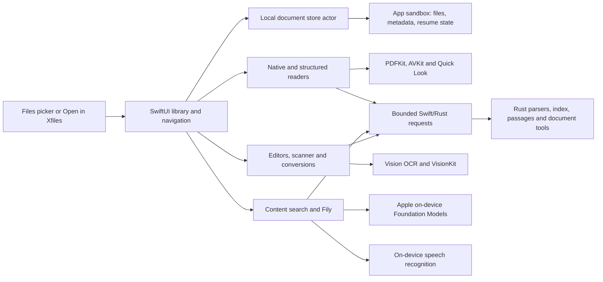

# Xfiles for iPhone and iPad

## High-level design

Xfiles for iOS uses SwiftUI and Swift 6 language mode with an iOS and iPadOS 17 deployment target. Platform UI, playback, camera, speech, and AI are hosted by the iOS target. Structured parsing and the document operations already available in Rust are shared with Android. The app keeps its own imported copies and works offline after import.

## Low-level design

| Boundary | Ownership and behavior |
| --- | --- |
| Library | SwiftUI owns navigation and presentation. The main-actor library model publishes file metadata, bookmarks, recents, and import state. The store actor holds security-scoped access during coordinated imports and atomically publishes the owned copy and metadata. |
| Bridge | Xcode builds the existing `document-ffi` static library for the active destination. Swift uses a C header to send JSON requests to an iOS-only Rust adapter. Each request runs off the main actor, owns a cancellation job, and releases Rust allocations at the boundary. The Android UniFFI API remains available. |
| Readers | PDFKit, AVKit, and a UIKit text surface handle the native reader paths. The Rust adapter sends a bounded structured preview for Office, EPUB, spreadsheets, and slides. EPUB uses chapter starts, inline styles, links, and footnotes. Sheets can freeze the first row and column. Slides use the engine’s shape geometry and embedded resources. Quick Look handles formats outside these reader paths when supported. |
| Position | Persist PDF page, text offset, playback timestamp, or structured section and block. Save while reading and flush on departure or backgrounding. Resume media paused. |
| Search | The store gives the Rust index only owned library files. Rust serializes index writes, removes stale entries on search, and returns snippets with the PDF page whenever available. Filename search remains available independently. |
| Fily | Library retrieval uses the local index. Open-document questions may also use the Rust hybrid passage cache. Answers use the local Foundation Models provider when iOS 26+ and the device make it available. Sources and deterministic find/open/page commands work independently. The model receives excerpts and has no file-action tool authority. Dictation requires the on-device speech route and user permission. |
| Editing and tools | Text and document edits generate separate files in temporary storage. Rust handles PDF rewrites, markup, watermarking and drawn signatures, Office replacement, XLSX cell editing, PPTX ordering, and ZIP extraction. Platform tools handle scan capture, OCR, text/images to PDF, ZIP creation, and duplicate detection. Successful outputs are published to the library under new IDs. |
| Accessibility | Use native controls, support VoiceOver and system gestures, and respect Reduce Motion for library transitions. Platform features expose unavailable states. |

## Implementation and validation plan

| Step | Status |
| --- | --- |
| App structure and library | Implemented in source. Validate import from Files providers, large files, app restart, and two iPad windows. |
| Rust bridge and document readers | Implemented in source. Verify linking on device and simulator, EPUB chapters and footnotes, pinned panes, slideshow links, password handling, and media resources. |
| Full-text search and offline Fily | Implemented in source. Check PDF citation jumps, concurrent searches, stale entries, model availability, and offline dictation. |
| Editing and conversion | Implemented in source. Check that inputs stay byte-for-byte unchanged, verify generated PDFs and ZIPs, and validate scanner OCR on an iPhone or iPad. |
| Xcode build, signing and device approval | Pending macOS, Xcode, and explicit build or test authorization. The shared Xfiles scheme is configured for this step. |

### Current platform limits

- Office previews are Xfiles renderings of the parsed content. Pixel-level fidelity, spreadsheet formula recalculation, and desktop Office editing are outside the current reader.
- EPUB uses scrolling chapter views and saved block positions. Android's paged layout, reading annotations, and notebook are separate feature work.
- AVKit plays iOS-supported codecs and offers tracks that the asset exposes. Android's FFmpeg/Media3 decoder fallback and the advanced player enhancements have no iOS counterpart in this delivery.
- Archive browsing and extraction cover ZIP. The archive reader imports requested entries individually. Duplicate detection compares exact content.
- Content search is based on text that the engine can extract. Password-protected files are not indexed, and scanned documents need an OCR text layer to participate.
- The iOS Fily provider is Apple's on-device model. The Android GGUF backend and the full Android action set are separate. Availability of the model, dictation, and voices depends on the device and configuration.

### Primary references

- [Apple WWDC26 iOS guide](https://developer.apple.com/wwdc26/guides/ios)
- [SwiftUI Observation](https://developer.apple.com/documentation/swiftui/migrating-from-the-observable-object-protocol-to-the-observable-macro)
- [PDFKit](https://developer.apple.com/documentation/pdfkit) · [AVKit](https://developer.apple.com/documentation/avkit) · [Quick Look](https://developer.apple.com/documentation/quicklook)
- [VisionKit document scanner](https://developer.apple.com/documentation/visionkit/vndocumentcameraviewcontroller)
- [Foundation Models](https://developer.apple.com/documentation/foundationmodels/systemlanguagemodel)
- [On-device speech recognition](https://developer.apple.com/documentation/speech/sfspeechrecognitionrequest/requiresondevicerecognition)
