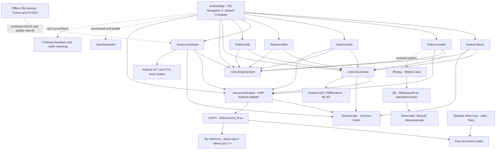
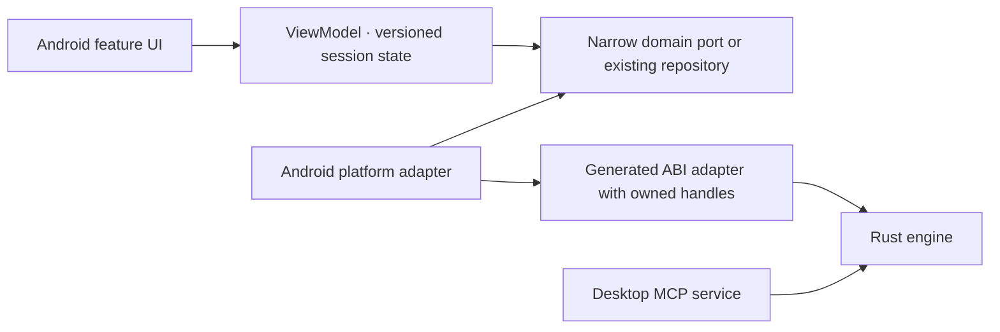

# Architecture review

## Present architecture

The observed public graph has thirteen Gradle modules. Two KMP modules use the Android-KMP library plugin. `:sharedLogic` contains common models, rules and tests. `:documentEngine` adds Android I/O adapters and generated bindings. The repository has no iOS application or enabled iOS target. The FFmpeg native library has a separate Cargo lock. The desktop MCP crate is a ninth engine workspace member and is excluded from default members. No cycle was found in the public Gradle declarations. The optional private settings and app overlays are outside the public graph and were excluded from review. [Settings](../../settings.gradle.kts#L17) · [App Gradle](../../androidApp/build.gradle.kts#L142) · [Shared logic](../../sharedLogic/build.gradle.kts) · [Android adapter](../../documentEngine/build.gradle.kts) · [Reader dependencies](../../feature/reader/build.gradle.kts#L31) · [Workspace](../../engine/Cargo.toml#L1)

| Owner | Current responsibility | Improvement with concrete payoff |
|---|---|---|
| App and Android features | UI state, navigation, Android share and open intents, voice overlay, AppFunctions, Glance, camera and platform permissions. | Keep constructor injection and feature MVVM/UDF. Centralize launch policy and authorized handoffs after consent verification. |
| Core documents | SAF access, folders, recents, bookmarks, reader IO, staging, Android PDF, OCR and publication. | Give reads and edits an explicit session. Consolidate Office export ownership after both callers have rollback tests. |
| Shared logic | File and reader types, Tidy ports, book and PDF policies, Fily tools, grounding, passages and UI-independent decisions. | Place portable decisions here. Keep provider manipulations and Android types at adapters. Preserve common schemas and persisted IDs. |
| Android engine adapter | Descriptor and data conversion, structured parsing, editing, PDF tools, text index, analysis and inference. | Keep native types internal and define per-call ownership. Where a feature needs a test seam, expose the narrow contract for that workflow. |
| Rust | Streaming parse and edit, bounded analysis and indexing, archive, similarity, image operations and model inference. | Keep native resource and format ownership. Improve durable write and cancellation paths without moving Android UI policy. |
| Desktop MCP | Explicit directory roots, validated arguments, bounded blocking jobs and staged outputs. | Keep host transport isolated. Extend request cancellation to job end and output publication. |
| Firebase and optional media | Firebase source sets separate cloud destinations from local sharing. Java Media3 APIs dispatch to standalone Rust JNI for optional audio decoders. | Keep optional services explicit in release checks. Produce equivalent behavior from a clean build. |

Clean or hexagonal architecture has a concrete use at file, speech, clock and native adapters. The feature split already gives team ownership without a new domain or plugin framework. Use use cases for workflow invariants shared by multiple callers. Keep small pure rules as functions. The highest-risk broad classes are the app shell and document analysis ViewModel because asynchronous handoffs cross their state. Existing reader controller extraction gives a place to enforce session lifetime. [Android architecture recommendations](https://developer.android.com/topic/architecture/recommendations) · [Reader session controllers](../../feature/reader/src/main/kotlin/com/xfiles/feature/reader/DocumentAnalysisViewModel.kt#L178)

## Decisions

| Choice | Pros | Cons and recommendation |
|---|---|---|
| OxiKT or Gobley | OxiKT and UniFFI already serve the current ABI. Both can be evaluated for future platform support. | Changing generator affects task wiring, generated package and release certification. Keep OxiKT 1.4.0 with UniFFI 0.32.0 and certify it against the actual build stack. [OxiKT](https://github.com/UbiqueInnovation/oxikt) · [Gobley](https://github.com/gobley/gobley) |
| Fily in Rust or dedicated JNI module | Current Rust worker owns context, generation and KV reuse. Native binding is already shipped through the document bridge. | Optional GPU driver linkage and process isolation need evidence. Keep Rust and CPU fallback. Consider a separate optional native library only if isolating OpenCL requires it. [Rust review](RUST_REVIEW.md) |
| Existing split or more KMP modules | Android presentation remains native and portable rules already live in KMP. | A wider split increases build and API surface. Keep the module count until an iOS target or independent ownership needs a new one. Add the iOS umbrella only when Swift has multiple framework producers to consume. [JetBrains structure](https://blog.jetbrains.com/kotlin/2026/05/new-kmp-default-structure/) |
| Same media build or explicit native feature | Platform codecs cover many files, while the optional decoder covers additional audio formats. | Silent omission makes local and CI capabilities inconsistent. Define a release contract and check per-ABI decoder binaries and playback. [Media3 supported formats](https://developer.android.com/media/media3/exoplayer/supported-formats) |

Preserve the installed identity `com.xfiles`, Xfiles name, voice-only Fily, current model names and URLs, Android-native look and document data compatibility. An iOS proof should validate one shared policy path and one Rust read before adding platform UI or inference. [Version and identity](../../androidApp/build.gradle.kts#L47) · [Model definitions](../../sharedLogic/src/commonMain/kotlin/com/xfiles/fily/ModelDownloads.kt)
