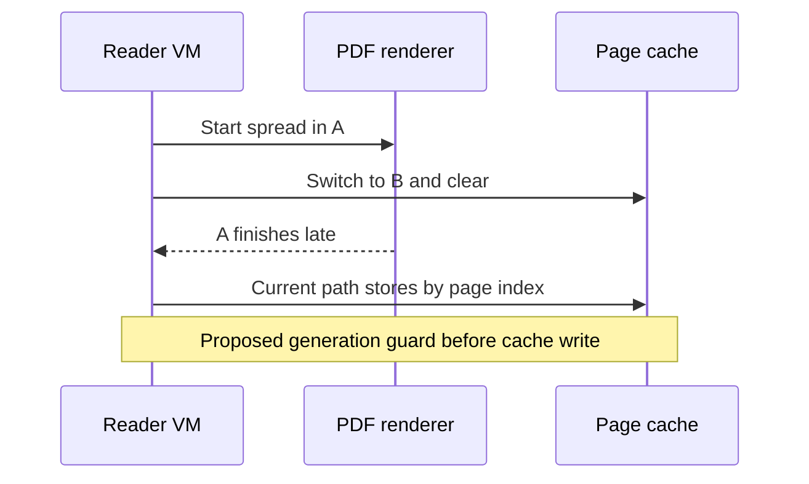
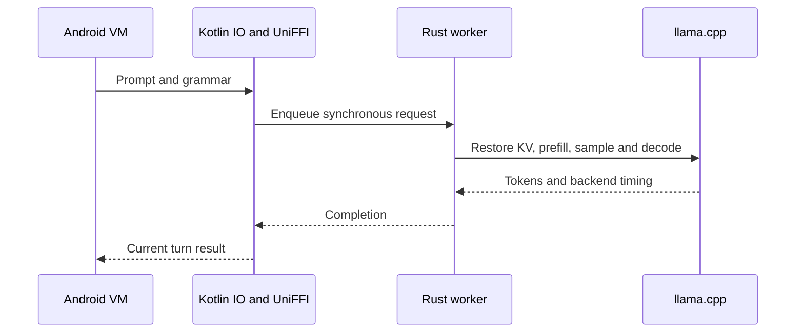
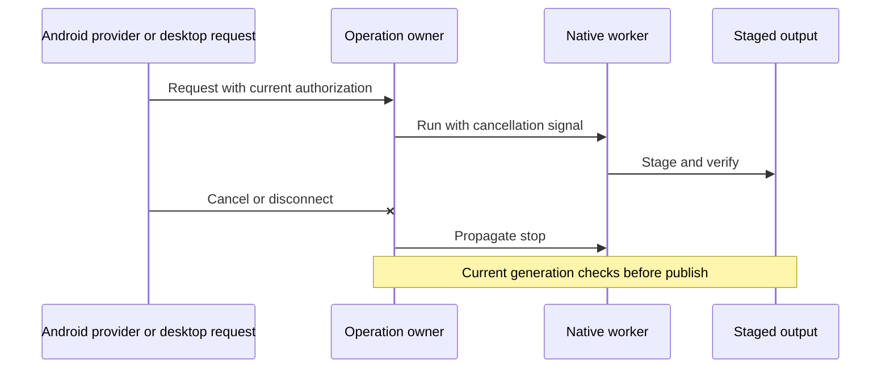

# Threading and execution flow

Dispatcher labels describe the intended calling lane. Rust and platform components can add threads. Limited parallelism limits simultaneous execution segments. Use an owner for invariants that span suspension. [Dispatcher semantics](https://kotlinlang.org/api/kotlinx.coroutines/kotlinx-coroutines-core/kotlinx.coroutines/-coroutine-dispatcher/limited-parallelism.html)

| Workflow | Threads and invariant |
|---|---|
| Android host | Activity and Compose on main, provider lookups in repository IO. Check consent when a handoff is consumed and keep stale intents from overriding current state. [Activity](../../androidApp/src/main/kotlin/com/xfiles/android/MainActivity.kt#L123) |
| Library | ViewModel, provider queries on IO, serialized Rust index under Mutex. Measure index refresh lock hold and user-query wait. [Search](../../core/documents/src/main/kotlin/com/xfiles/core/documents/LibrarySearchRepository.kt#L41) |
| PDF and OCR | Main UI and reader cache, background PdfRenderer, async ML Kit Task. Enforce session identity before every cache write and bitmap lifetime until Task completion. [Cache](../../feature/reader/src/main/kotlin/com/xfiles/feature/reader/domain/PdfPagesUseCase.kt#L38) · [OCR](../../core/documents/src/main/kotlin/com/xfiles/core/documents/TextRecognitionRepository.kt#L39) |
| Office and archive | UI scope to provider staging and blocking Rust, with a final Android publish. Target cancellation to native operation ownership, and distinguish transform from publish failure. [Office](../../core/documents/src/main/kotlin/com/xfiles/core/documents/OfficeEditRepository.kt#L99) · [Archive](../../core/documents/src/main/kotlin/com/xfiles/core/documents/ArchiveRepository.kt#L117) |
| Fily and install | Android main recognizer/TTS, Kotlin background adapter, Rust worker and llama.cpp threads. Model transfer uses separate scoped IO. Generation gates progress, terminal results and GPU fallback. [Inference](../../documentEngine/src/androidMain/kotlin/com/xfiles/documentengine/FilyInference.kt#L68) · [Install](../../feature/assistant/src/main/kotlin/com/xfiles/feature/assistant/AndroidModelDownloads.kt#L119) |
| Media and camera | Main platform lifecycle, ExoPlayer or CameraX worker lanes and optional FFmpeg JNI. Test seek, reset and close while work is active. [Media](../../feature/reader/src/main/kotlin/com/xfiles/feature/reader/MediaScreen.kt#L31) |
| Feedback | ViewModel invokes Firebase Task that can outlive a request while queued. UI should display delivery state and errors faithfully. [Sender](../../androidApp/src/firebase/kotlin/com/xfiles/android/feedback/FirestoreFeedbackSender.kt#L26) |
| Desktop | Tokio stdio requests, bounded blocking worker, parser and filesystem. Worker retains the permit until exit. Propagate drop cancellation and authorize only current staged output. [Jobs](../../engine/crates/xfiles-mcp/src/jobs.rs#L63) |

Use existing producer-consumer lanes for inference and MCP. Use small state machines for install, export and handoff. Bound expensive pipelines where ownership can be verified. Measure queue delay, contention, native run time and cancellation separately before adding dispatchers or event infrastructure. [Coroutine cancellation](https://kotlinlang.org/api/kotlinx.coroutines/kotlinx-coroutines-core/kotlinx.coroutines/with-context.html) · [Tokio blocking ownership](https://docs.rs/tokio/latest/tokio/task/fn.spawn_blocking.html)
